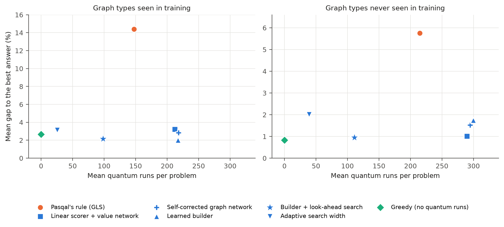

# Learned piece selection for neutral-atom quantum optimization

Pasqal's neutral-atom machines solve maximum independent set directly, but only on pieces of a few dozen atoms, so larger graphs are split with a divide-and-conquer method ([Cazals et al., arXiv:2508.06130](https://arxiv.org/abs/2508.06130)) whose pieces are chosen by a fixed rule, GLS. This repository replaces that rule with learned models and compares them with GLS, an exact solver and min-degree greedy on generated graphs, on Pasqal's cloud emulator, and on S&P 500 correlation graphs from 2005 to 2026.

On 520 fresh test graphs, the best models cut GLS's gap to the optimum from 14.4% to about 2% on graph types seen in training, and from 5.8% to about 1% on unseen ones. Min-degree greedy, which uses no quantum runs, does about as well, so this is not a quantum advantage result.



## Install

```bash
git clone https://github.com/hbofz/pasqal-learned-selection.git
cd pasqal-learned-selection
uv sync
uv run pytest -q
```

Python 3.12. Set `OMP_NUM_THREADS=1` when running several workers.

## Usage

Run methods on a few generated graphs:

```bash
uv run python -m learned_selection.bench --family er --params p=0.25 --n 100 --seeds 0-1 \
    --methods gls,bld-h3+dgin-h4+dgin-h5,greedy-mindeg,exact --widths 4,2,10 --restarts 1 --out results/demo.jsonl
```

Each run appends one JSON record (set size, gap, quantum runs, timing, commit), and a rerun skips what is already in `--out`. Other entry points, each with `--help`:

| Module | Purpose |
|---|---|
| `learned_selection.curves` | gap against quantum runs, with bootstrap intervals and plots |
| `learned_selection.emuval` | whole decompositions with the exact, random or cloud piece solver |
| `learned_selection.portfolio` | the S&P 500 grid (needs `scripts/fetch_market.py` first) |
| `learned_selection.train`, `dagger`, `builder`, `pg`, `bandit`, `gfn`, `az`, `evolve` | training |

## Methods

| Method string | Model |
|---|---|
| `gls` | Pasqal's rule (baseline) |
| `lin-h2h4+sage-h5` | linear scorer with a graph-network value model |
| `dgin-h2h4h5` | graph networks retrained on their own decisions |
| `bld-h3+dgin-h4+dgin-h5` | learned piece builder |
| `bld-h3+sage-h4+dsage-h5+mcts-c0.5` | builder with look-ahead tree search (run at `--widths 4,2,100`) |
| `bandit-r` | adaptive search width |
| `greedy-mindeg`, `exact` | classical references |

Trained weights are in `models/`.

## Layout

- `learned_selection/`: the engine, models, training, benchmark, cloud solver and market code
- `vendor/pasqal_docking/`: Pasqal's GLS code, unchanged, with its licence
- `models/`: trained weights
- `results/eval/`: every record behind the reported numbers; `results/raw/`: saved emulator answers and the market data manifest
- `scripts/`: the README figure and the price download
- `tests/`: the test suite

## Notes

- Prices are not in the repository because of Yahoo's terms; `scripts/fetch_market.py` downloads them. A new download will not match the hashes in `results/raw/market6_manifest.json`.
- Records should be replayed on the machine that made them, because the graph networks break ties differently across machines. Emulator runs replay offline from the saved answers with `--replay`.
- New emulator jobs need a Pasqal account. The login is read from the macOS Keychain or `~/.config/pasqal/login` (username, then password, mode 600), and the project ID is set in `learned_selection/cloud.py`.

## Citation

Cazals, Sorondo, Onofre, Dalyac, da Silva Coelho and Vitale. Quantum optimization on Rydberg atom arrays with arbitrary connectivity: gadgets limitations and a heuristic approach. *Physical Review A* 112, 062416 (2025). [arXiv:2508.06130](https://arxiv.org/abs/2508.06130).
